<div align="center">

# veri

<p>
  <strong>Multi-provider web search and clean Markdown extraction for AI agents and developers</strong><br>
  Single pure-Go binary with zero runtime dependencies — shipping a <strong>CLI</strong>, <strong>MCP Server</strong>, and <strong>Agent Skill</strong>
</p>

**[简体中文](./README.md)** · **[English](./README.en.md)**


<br>



</div>

---

## 📦 Download & Installation

### Install Script

**macOS / Linux**

```sh
curl -fsSL https://raw.githubusercontent.com/maybk/veri/main/scripts/install.sh | sh
```

**Windows (PowerShell)**

```powershell
irm https://raw.githubusercontent.com/maybk/veri/main/scripts/install.ps1 | iex
```

### Package Managers

**Homebrew (macOS / Linux)**

```bash
brew install maybk/tap/veri
```

**Scoop (Windows)**

```powershell
scoop bucket add maybk https://github.com/maybk/homebrew-tap
scoop install maybk/veri
```

<!-- Enabled once the official WinGet PR is merged
**WinGet (Windows)**

```powershell
winget install maybk.Veri
```
-->

### Manual Download

Prebuilt archives and `SHA256SUMS.txt` checksums are available on [GitHub Releases](https://github.com/maybk/veri/releases); standalone installs can check and upgrade directly via `veri update`. To build from source, see the [Development & Build Guide](./docs/guide/development.md).

## 🚀 Quick Start

> Web page and GitHub extraction works **out of the box with no API keys**; configuring any single search provider key unlocks web search and cloud extraction. See the [Usage Guide](./docs/guide/usage.md) for full walkthroughs and official API key portals.

### 1. Configure API Keys

Credentials are encrypted under `~/.config/veri/` and shared automatically between the CLI and MCP server:

```bash
veri key set exa
veri key list
```

You can also configure keys via `~/.config/veri/config.toml` or environment variables (environment variables always take precedence):

```bash
export EXA_API_KEY="exa_..."
```

Check active providers and health:

```bash
veri providers
veri doctor
```

### 2. Command-Line Usage

```bash
# Extract web pages or GitHub repos / issues / PRs (no API key required)
veri fetch https://github.com/modelcontextprotocol/go-sdk
veri fetch https://example.com/article --section "Authentication" --max-chars 20000

# Web search (requires any one search provider key)
veri "golang mcp sdk official"
veri search "go 1.27 release notes" -t 6m -s go.dev -n 5

# Concurrent fusion search with JSON output
veri search "raft leader lease" --fusion -p exa,tinyfish --json
```

### 3. MCP Server Integration

Register `veri mcp` in your MCP client (or run `veri mcp config` to generate the JSON snippet); keys stored locally are shared automatically with no need to duplicate `env`:

```json
{
  "mcpServers": {
    "veri": {
      "command": "veri",
      "args": ["mcp"]
    }
  }
}
```

### 4. Agent Skill Installation

Recommended via [`npx skills`](https://skills.sh) for unified multi-agent installation and updates:

```bash
npx skills add maybk/veri
```

In offline or Node-free environments:

```bash
veri skill install   # Write to the standard .agents/skills directory
veri skill print     # Print the embedded SKILL.md
```

## ✨ Features

### 🎯 Core Capabilities

- **Multi-Provider Search & Fallback** - Built-in support for DeepSeek, Exa, TinyFish, Tencent WSA, Tavily, and Brave, enabled automatically from configured keys; supports automatic failover, language-aware routing, and concurrent fusion deduplication
- **Clean Web & GitHub Extraction** - Built-in structured GitHub reader and pure-Go local extractor turn pages and repos / issues / PRs / commits into clean Markdown with zero keys; configured cloud extractors add dynamic rendering and PDF support, plus batch fetching, section slicing, and keyword matching
- **Unified Filter Syntax** - One consistent set of flags for time windows, site allow/block lists, and language filters across providers, with strict native enforcement when needed
- **CLI / MCP / Skill in One Binary** - One static executable delivers an interactive/scriptable CLI, a standard stdio MCP server, and Agent Skill integration for AI agents

### 🔧 Security & Reliability

- **SSRF Protection & Proxy Friendly** - Local fetching blocks loopback, private, and cloud metadata targets by default while working smoothly with transparent proxy (TUN) setups
- **Billing-Safe Retries & Key Pools** - Never blindly replays timed-out or dropped requests; supports round-robin multi-key pools with cooldowns and tracks cost only from explicit pricing or upstream billing
- **Encrypted Storage & Safe Outputs** - Encrypts API keys locally, redacts secrets in logs and diagnostics, and isolates external content in MCP outputs to mitigate prompt injection
- **Automatic CLI Localization** - Detects OS language for human CLI output (`zh-CN` / `en-US`) while keeping `--json`, MCP schemas, and `SKILL.md` in deterministic English

## 🖥️ Supported Platforms

- **macOS** - macOS 13.0 (Ventura) or later, Apple Silicon (`arm64`) and Intel (`amd64`)
- **Windows** - Windows 10 / 11 (`amd64` / `arm64`)
- **Linux** - Static binaries for `amd64` and `arm64`

## 🏗️ Architecture

- **Go 1.27+** - Pure-Go static binary with zero runtime dependencies
- **`modelcontextprotocol/go-sdk`** - Official MCP stdio server and structured input/output schemas
- **`spf13/cobra` + `BurntSushi/toml`** - CLI command routing and strict TOML configuration decoding
- **`go-readability` + `x/net/html`** - Pure-Go local main-content extraction and compact Markdown conversion

```text
main.go -> internal/cli | internal/mcpserver -> internal/app -> internal/router -> internal/provider/* -> internal/httpx
```

## 📚 Documentation

- [Usage Guide](./docs/guide/usage.md)
- [Overview & Directory Layout](./docs/guide/overview.md)
- [Configuration Guide](./docs/guide/configuration.md)
- [Providers & Routing Guide](./docs/guide/providers.md)
- [Development & Build Guide](./docs/guide/development.md)
- [Release Guide](./docs/guide/release.md)
- [Changelog](./CHANGELOG.md)

## ⚠️ Disclaimer

1. **Compliance** - Use this tool in accordance with applicable laws, target website terms of service, and upstream API policies.
2. **Privacy** - Configuration files and API keys stay in `~/.config/veri/` on your local machine and are sent only to the upstream providers you configure; `veri` contains no telemetry.
3. **Liability** - Search results and extracted web pages originate from third-party sources; the authors assume no liability for external content accuracy or upstream API charges.

---

<div align="center">
  <p>If you find this project helpful, please consider giving it a ⭐️!</p>
</div>

[](https://www.star-history.com/#maybk/veri&Date)
