<div align="center">

# veri

<p>
  <strong>面向 AI Agent 和开发者的多源联网检索与网页 Markdown 提取工具</strong><br>
  纯 Go 单二进制，零运行时依赖，同时提供 <strong>CLI</strong>、<strong>MCP Server</strong> 与 <strong>Agent Skill</strong>
</p>

**简体中文** · **[English](./README.en.md)** &nbsp;|&nbsp; **[使用指南](./docs/guide/usage.md)**


<br>



</div>

---

## 📦 下载与安装

### 一键脚本安装

**macOS / Linux**

```sh
curl -fsSL https://raw.githubusercontent.com/maybk/veri/main/scripts/install.sh | sh
```

**Windows（PowerShell）**

```powershell
irm https://raw.githubusercontent.com/maybk/veri/main/scripts/install.ps1 | iex
```

### 包管理器安装

**npm（macOS / Linux / Windows）**

```bash
npm install -g @maybk/veri
```

**Homebrew（macOS / Linux）**

```bash
brew install maybk/tap/veri
```

**Scoop（Windows）**

```powershell
scoop bucket add maybk https://github.com/maybk/homebrew-tap
scoop install maybk/veri
```

**mise（macOS / Linux / Windows）**

```bash
mise use -g npm:@maybk/veri      # 或 mise use -g github:maybk/veri
```

<!-- WinGet 官方源 PR 待合入后启用
**WinGet（Windows）**

```powershell
winget install maybk.Veri
```
-->

### 手动下载

预编译压缩包与 `SHA256SUMS.txt` 校验文件可从 [GitHub Releases](https://github.com/maybk/veri/releases) 下载；一键脚本或手动安装的二进制可通过 `veri update` 检查并升级。如需从源码构建，请参阅[开发与构建指南](./docs/guide/development.md)。

## 🚀 快速开始

> [!TIP]
> 网页正文与 GitHub 页面提取**无需任何 API Key，安装后即可直接使用**；只需配置任意一个检索源密钥，即可启用联网搜索与云端增强提取。完整教程、命令配方与常见问题请参阅 **[使用指南](./docs/guide/usage.md)**。

### 1. 配置 API Key

凭据统一加密保存在 `~/.config/veri/`，CLI 与 MCP 服务端自动共享（[各检索源免费额度与官方申请入口](./docs/guide/usage.md#选型与官方申请入口)）：

```bash
veri key set deepseek
veri key list
```

也可通过环境变量传入密钥（优先级最高），更多配置项用法见[配置说明](./docs/guide/configuration.md)：

```bash
export DEEPSEEK_API_KEY="sk-..."
```

查看已启用的检索源与环境状态：

```bash
veri providers
veri doctor
```

### 2. 命令行使用

```bash
# 提取网页或 GitHub 仓库 / Issue / PR（无需密钥，开箱即用）
veri fetch https://github.com/modelcontextprotocol/go-sdk
veri fetch https://example.com/article --section "Authentication" --max-chars 20000

# 联网检索（需配置任意一个检索源密钥；可直接传入查询词，或通过 search 指定过滤参数）
veri "golang mcp sdk official"
veri search "go 1.27 release notes" -t 6m -s go.dev -n 5

# 多源并发融合检索与 JSON 输出
veri search "raft leader lease" --fusion -p deepseek,exa --json
```

### 3. 接入 MCP 客户端

在支持 MCP 的客户端中注册 `veri mcp`，即可挂载 `web_search` 与 `web_fetch` 工具并复用进程内缓存（可执行 `veri mcp config` 生成配置片段）；本机已保存的密钥会自动生效，无需在 `env` 中重复填写：

```json
{
  "mcpServers": {
    "veri": {
      "command": "veri",
      "args": ["mcp"]
    }
  }
}
```

未全局安装时，也可通过 `npx` 直接启动：

```json
{
  "mcpServers": {
    "veri": {
      "command": "npx",
      "args": ["-y", "@maybk/veri", "mcp"]
    }
  }
}
```

### 4. 安装 Agent Skill

为支持命令行调用的编码 Agent 提供检索策略与提取配方（可单独配合 CLI，也可与 MCP 搭配使用）。推荐通过 [`npx skills`](https://skills.sh) 为各类 AI Agent 统一安装与更新：

```bash
npx skills add maybk/veri
```

离线或无 Node.js 环境下，可直接使用内置命令：

```bash
veri skill install   # 写入标准 .agents/skills 目录
veri skill print     # 输出内置 SKILL.md 原文
```

## ✨ 功能特性

### 🎯 核心功能

- **多源检索与自动回退** - 内置 DeepSeek、Keenable、知乎、Exa、TinyFish、腾讯云联网搜索、Tavily、Brave、Linkup、Parallel 与 Firecrawl 检索源，配置密钥后自动启用；支持故障自动切换、中英文智能选路与多源并发融合去重
- **网页与 GitHub 正文提取** - 内置 GitHub 结构化读取器与纯 Go 本地提取器，无需密钥即可将普通网页与 GitHub 仓库 / Issue / PR / Discussion / Commit / Release 转为干净的 Markdown；配置云端提取源后可扩展动态网页渲染与 PDF 提取，并支持批量抓取、章节截取与关键词定位
- **统一过滤语法** - 使用统一参数指定时间范围、站点包含/排除与语言条件，自动抹平各检索源接口差异，也可按需开启严格原生过滤
- **CLI / MCP / Skill 三合一** - 单个静态二进制同时提供命令行工具、标准 stdio MCP 服务端与 Agent Skill，开箱即用，轻松接入各类 AI Agent

### 🔧 安全与可靠性

- **内网隔离与代理兼容** - 本地抓取默认拦截本机、内网与云元数据地址以防范 SSRF，同时兼容透明代理（TUN）网络环境
- **防误扣费与多密钥轮换** - 请求超时或连接中断时不盲目重放，避免重复计费；支持同源多密钥轮询与故障冷却，仅在上游返回实际账单或手动配置单价时统计成本
- **本地加密与安全输出** - API 密钥本地加密存储，日志与诊断输出自动脱敏；MCP 文本输出自动包裹外部内容隔离标签，降低提示词注入风险
- **中英文界面自适应** - 终端交互按系统语言自动切换中英文，JSON 输出、MCP 协议与 `SKILL.md` 固定采用英文格式，保证机器解析稳定

## 🖥️ 支持平台

- **macOS** - macOS 13.0（Ventura）及以上，支持 Apple Silicon（`arm64`）与 Intel（`amd64`）
- **Windows** - Windows 10 / 11（`amd64` / `arm64`）
- **Linux** - 主流发行版纯静态二进制（`amd64` / `arm64`）

## 🏗️ 技术架构

- **Go 1.27+** - 纯静态单二进制编译，无外部运行时依赖
- **`modelcontextprotocol/go-sdk`** - 标准 MCP stdio 服务端与输入/输出 Schema
- **`spf13/cobra` + `BurntSushi/toml`** - 命令行解析与配置校验
- **`go-readability` + `x/net/html`** - 纯 Go 本地网页正文提取与紧凑 Markdown 转换

```text
main.go -> internal/cli | internal/mcpserver -> internal/app -> internal/router -> internal/provider/* -> internal/httpx
```

## 📚 项目文档

- [使用指南](./docs/guide/usage.md)
- [项目概览与目录结构](./docs/guide/overview.md)
- [配置说明](./docs/guide/configuration.md)
- [检索与提取源说明](./docs/guide/providers.md)
- [开发与构建](./docs/guide/development.md)
- [发布指南](./docs/guide/release.md)
- [更新日志](./CHANGELOG.md)

## ⚠️ 免责声明

1. **合规使用** - 请在遵守当地法律法规、目标站点服务条款及各上游 API 使用协议的前提下使用本工具。
2. **数据隐私** - 配置文件与 API 密钥仅保存在本机 `~/.config/veri/`，调用时直连已启用的对应上游接口；`veri` 自身无中转服务，也不包含任何遥测或数据收集行为。
3. **使用风险** - 检索结果与网页正文均来自第三方公开网络，开发者不对外部内容的准确性或调用上游接口产生的费用承担责任。

---

<div align="center">
  <p>如果这个项目对您有帮助，请给个 ⭐️ 支持一下！</p>
</div>

[](https://www.star-history.com/#maybk/veri&Date)
